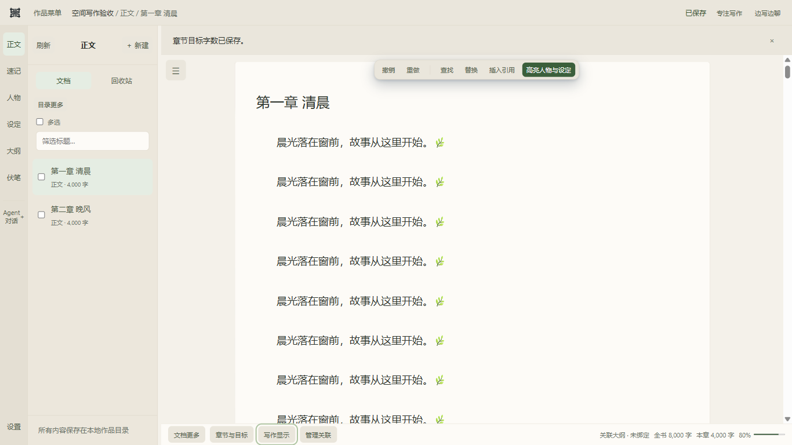

# ZestLoomer 新工作区

适用版本：`0.1.0-beta.3`。安装与完整迭代说明见 [主 README](README.md)，日常操作见 [使用指南](docs/USER-GUIDE.md)。

## 写作空间

- 单层顶栏集中作品菜单、当前文档位置、保存状态、专注写作与边写边聊。
- 左侧窄导航保留正文、大纲、人物、设定、速记与伏笔。目录宽度可在 180–360px 间调整，窄窗口下改为浮层，AI 会话继续保留。
- 标题随正文滚动，浮动工具提供撤销、重做、查找替换、引用与人物／设定高亮。底栏提供文档操作、章节目标、关联管理与字数统计。
- 纸张式正文、蓝色选区和可选版心宽度；作品菜单可切回经典布局。

## 写作交互

`Ctrl+F`／`Ctrl+H` 打开浮层查找替换，`Enter`／`Shift+Enter` 切换匹配，`Esc` 返回正文。普通专注与 `F11` 全屏禅意分开控制，退出全屏时恢复原专注状态。

底栏「写作显示」可设置版心、工具常驻、打字机模式和中文选区符号配对。打字机与中文配对默认关闭；标题、视觉缩进和打字机留白不写入正文。

切章复用编辑器，各章分别保留撤销与阅读位置；受控 AI 修改后的撤销仍使用提案操作。设置、导入、历史等窗口按需加载，大段修改对照按需在后台计算。

## 验证与边界

本版累计 40 个不同桌面用例通过，真实模型用例跳过，详细口径见 [发布前验证](docs/verification/ZestLoomer-beta.3-2026-10-28.md)。截图使用独立合成书稿，不含个人作品。

实体悬浮卡、行内 AI、正文 Diff 投影与逐段采纳尚未实现。中文输入法候选窗、125%／150% 系统缩放与长期写作仍需人工体验。长会话历史重读仍有已知问题，详见 [已知限制](docs/release/KNOWN-ISSUES.md)。
