# ZestLoomer 图文使用指南

**适用 2026-11-15 开发版。** 本文以新布局和《压测人员的生活》的演示副本说明操作。开发版的入口和功能可能与公开的 `0.1.0-beta.3` 安装版不同。使用发布页安装包时，请阅读 [beta.3 对应的使用指南](release/USER-GUIDE-beta.3.md)；安装、升级与数据兼容范围见 [安装说明](release/INSTALL.md)。

[离线图文预览](USER-GUIDE.preview.html)：下载项目源码后用浏览器打开，并保留旁边的 `assets/user-guide` 截图目录；图片可点击放大。在线阅读直接查看本页即可。

先完成“打开作品 → 创建章节 → 配置 AI → 讨论与审阅提案”这一轮操作，再按需要查看资料、搜索和备份功能。未配置 AI 时，仍可使用本地写作、搜索、历史和导出。

## 目录

1. [认识工作区并打开作品](#1-认识工作区并打开作品)
2. [创建章节与开始写作](#2-创建章节与开始写作)
3. [连接 Gemini 或其他 AI 服务](#3-连接-gemini-或其他-ai-服务)
4. [与 AI 讨论、核查和修改](#4-与-ai-讨论核查和修改)
5. [整理人物、设定、大纲与伏笔](#5-整理人物设定大纲与伏笔)
6. [搜索、引用与返回原文](#6-搜索引用与返回原文)
7. [历史、回收、导出与备份](#7-历史回收导出与备份)
8. [调整显示与解决常见问题](#8-调整显示与解决常见问题)

## 1. 认识工作区并打开作品

### 先看这几个位置

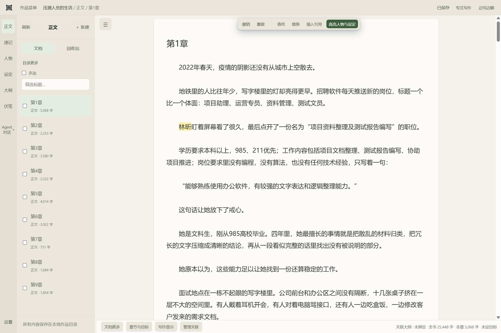

图：左侧选择资料分类和文档，中间写作，右侧在需要时展开 AI 对话。

| 位置 | 常用操作 |
| --- | --- |
| 顶栏 | 打开作品菜单、查看保存状态，切换「专注写作」和「边写边聊」 |
| 左侧创作分区 | 进入正文、大纲、人物、设定、速记和伏笔，打开设置 |
| 文档列表 | 新建、筛选、排序、多选，以及进入当前分类的回收站 |
| 中间编辑区 | 修改标题和内容；浮动工具提供查找、引用、撤销等操作 |
| 底栏 | 查看字数，使用「文档更多」「章节与目标」「写作显示」「管理关联」 |
| 右侧 AI 区域 | 管理对话，查看读取过程、回复、任务和修改提案 |

编辑区左上方的「☰」可展开或收起目录。窄窗口中，目录会覆盖在正文上方；展开后选中文档，再收起即可继续阅读。目录与 AI 面板都能拖动分隔线调整宽度。

### 打开已有作品

1. 点击顶栏「作品菜单 → 打开作品」。
2. 选择**直接包含 `book.json` 的作品文件夹**。
3. 确认作品名称和目录中的章节，再开始操作。

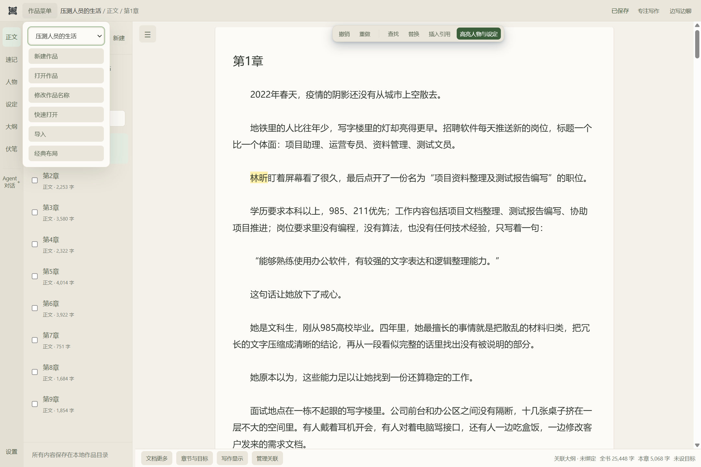

图：「打开作品」选择作品本身；菜单中的作品选择框用于切换已经打开过的作品。

不要选择作品文件夹的父目录，也不要选择某个章节文件夹。作品名称是界面上的显示名，不必与磁盘文件夹名称相同。建议记录作品的实际保存位置，方便备份和搬迁。

切换作品前，应用会处理当前保存状态。如果出现未保存内容或冲突提示，先处理提示。后台任务及其结果仍属于发起任务的作品；切回对应作品和对话后查看进度。

### 从空白开始

首次启动先选择或创建 BookList 书库。之后点击「作品菜单 → 新建作品」，填写书名并确认，应用会在当前 BookList 中新建独立作品文件夹，并进入工作区；不必为每一本新书再选择保存位置。接着按下一节创建第一章。

本指南使用已有作品的副本演示。自行体验时，也可以新建空作品，避免练习操作影响正式书稿。

## 2. 创建章节与开始写作

### 创建一章

1. 选择左侧「正文」，点击文档列表上方的「＋ 新建」。
2. 填写标题；使用编号时，副标题中不必再重复写“第几章”。
3. 选择插入位置，如列表末尾，或某一章之前／之后。
4. 查看预览中的最终标题与位置，确认后点击「创建」。

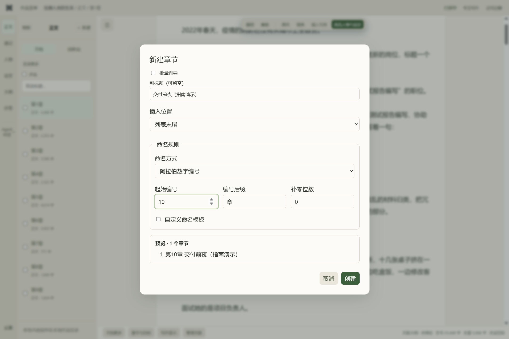

图：章号、章节标题和列表位置分别设置，以底部预览为准。第10章“交付前夜（指南演示）”仅在演示副本中新建，是练习章，不属于原稿情节；原稿本来有9章。

“第9章”这个名字不会自动决定它在列表中的位置。新建规则只影响后续创建，不会自动重命名已有章节。同名章节可以创建，但应使用自己容易辨认的标题。

### 写作与保存

在中间区域编辑标题和正文，等待顶栏显示「已保存」；也可按 `Ctrl+S` 主动保存。标题独立于正文显示，并随文档一起保存，不会额外写进正文。

正文采用纯文本编辑。当前开发版按段落输入，`Enter` 与 `Shift+Enter` 使用双换行；首行两字缩进是显示效果，不会向导出的文本额外添加全角空格。人物、设定等资料则直接编辑 Markdown 源码。

同一次运行中切换章节，会保留各章的选区、阅读位置和本地撤销历史。接受 AI 修改或恢复历史版本后，请使用对应的提案撤销或历史功能回退。

底栏显示本章、全书与选区字数。字数按去除空白后的字符统计，可能与投稿平台不同。在「章节与目标 → 章节目标」填写目标字数，填 `0` 表示不设目标；这个目标用于显示当前章节进度，不是每日写作目标。

### 已有章节的改名、复制与排序

- **改名**：直接修改正文上方的标题，留意保存状态。
- **复制**：打开「文档更多 → 复制」，生成独立副本；以后不会与原文同步。
- **移动**：使用列表中的上下箭头、拖动，或多选后使用「目录更多 → 移到…」。先清空标题筛选，便于核对完整顺序。
- **整理编号**：打开「目录更多 → 整理」，区分改变列表顺序、统一标题格式和按当前顺序连续编号；先查看预览，再应用。

排序后可用「撤销排序」恢复上次顺序。改名不属于排序撤销的范围；需要恢复原标题时，在历史版本中完整比较标题与正文，避免同时恢复了不需要的旧内容。

批量创建和自定义章号

新建窗口支持「批量创建」，可以每行填写一个副标题，也可以按数量创建 1–100 章。

编号可使用阿拉伯数字、汉字数字、自定义后缀和补零。自定义模板中：

| 写法 | 含义 |
| --- | --- |
| `{n}` | 阿拉伯数字 |
| `{cn}` | 汉字数字 |
| `{title}` | 副标题 |
| `{n:03}` | 三位补零数字 |

例如 `第{n:03}章 {title}`，编号为 9、副标题为“交付前夜”，预览就是“第009章 交付前夜”。自由标题配合按数量创建可能生成同名章节，创建前逐项核对预览。

## 3. 连接 Gemini 或其他 AI 服务

### 填写接入配置

本指南的 AI 操作使用 Gemini。你可以使用自己的 Gemini 服务，或支持 Chat Completions 兼容接口的其他服务；API 地址和模型名称以服务实际提供的内容为准。

| 本次演示项 | 配置 |
| --- | --- |
| 服务 | Google Gemini 的 Chat Completions 兼容接口 |
| API 地址 | `https://generativelanguage.googleapis.com/v1beta/openai/` |
| 模型标识 | `models/gemini-3.5-flash` |

这是本次演示使用的配置，不是所有服务通用的填写格式。使用其他接入平台时，按该平台提供的地址和模型标识填写。

1. 打开「设置 → AI 接入 → Agent API」。
2. 在「接入配置」选择「＋ 新增配置」，填写一个易于辨认的配置名称。
3. 填写 **API 地址**，保留服务要求的版本路径。可填基础地址或完整的 `/chat/completions` 地址。
4. 点击「获取模型列表」后选择模型，或填写准确的模型标识。
5. 填写自己的 API 密钥。已保存过密钥的配置，可以勾选保留原密钥。

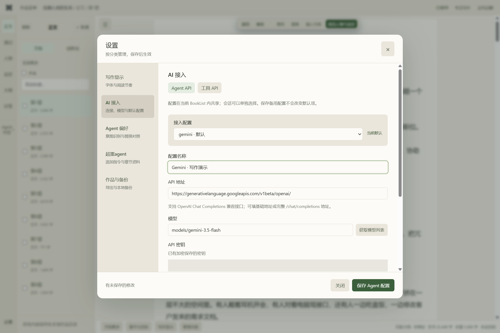

图：地址、模型和密钥共同决定使用哪项服务。截图不展示密钥，请填写自己的密钥。

### 两项测试都做，再保存

1. 点击「测试连接」，检查能否正常发出请求并收到回复。
2. 点击「测试工具调用」，检查模型与接口是否支持应用需要的工具调用。
3. 两项测试结果符合预期后，点击底部「保存 Agent 配置」。

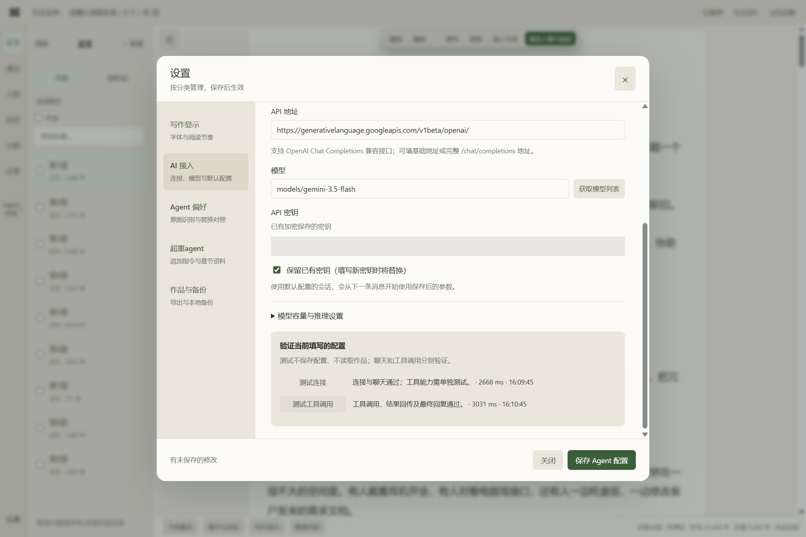

图：本次真实 Gemini 接入的连接测试与工具调用测试均通过，分别耗时2668毫秒和3031毫秒；测试成功后仍要保存配置。

本次工具测试走完了“模型发起工具调用 → 返回工具结果 → 模型给出最终回复”的完整链路。实际耗时会随模型、服务负载和网络变化，图中的数字仅代表这一次操作。

测试不保存配置，也不读取作品内容。改过地址、模型或密钥后，请重新测试。看不到按钮时，向下滚动设置窗口右侧的内容区域。

能收到聊天回复，不代表 Agent 一定能读取资料或提出修改。每次测试和对话都会实际调用所选服务，使用量按该服务的规则记录。

### 默认配置与当前会话

第一份配置自动成为默认项。保存备用配置不会自动切换默认项；需要切换时，勾选「保存后设为默认配置」。

对话面板中的「会话模型」可跟随默认配置，或指定其他已保存配置。新的参数从下一条消息开始使用，不会改写已有消息的模型记录。运行中的任务结束后，再保存配置参数。

模型容量、自动标题与额外上下文

- **模型容量与推理设置**：按服务实际能力填写上下文容量、输出上限和推理强度。填写更大数字不会增加模型能力；服务不支持推理参数时，使用「服务默认」。
- **工具 API**：这里用于给对话自动生成标题，不是控制 Agent 读取书稿的开关。可以选择已保存配置或跟随默认配置；手动改过的标题会保留。
- **Agent 偏好**：可调整提案对照的显示方式。意图识别与目标改写是实验选项，默认关闭，开启后可能增加模型请求。
- **超重agent**：可为新对话追加自定义指令、本章大纲与上下文等资料。先少量开启，并在发送后的上下文记录中核对。附带更多资料会增加请求内容；保存后影响新建对话，已有对话保留自己的设置快照。

这些配置在当前 BookList 的作品之间共享。请不要把 API 密钥写进书稿、人物资料或自定义指令中。

## 4. 与 AI 讨论、核查和修改

### 先建立一个范围清楚的对话

点击「边写边聊」展开面板，再点击「新对话」。可以按目的分别建立“本章讨论”“人物经历核对”“下一章方向”等对话，避免把许多不同任务混在一起。

发送前先打开相关文档。若只想处理一小段，选中那段文字，再输入要求。展开「发送上下文」，检查「附带当前文档位置」「附带选区原文」和下方的本次模型。

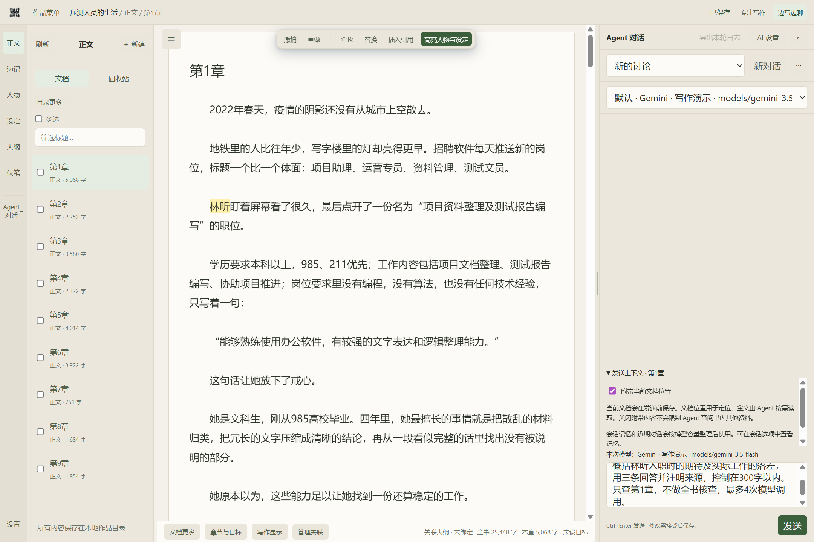

图：发送时的文档位置与选区会固定保存，之后切换文档不会改变已经发出的请求。

建议第一条消息只做讨论。本次示例要求阅读第1章，整理主角的入职期待与实际落差，并给出原文依据；没有要求修改书稿。可以这样描述目标：

> 只阅读当前打开的第1章，列出主角的3条入职期待与实际落差，并给出原文依据。先讨论，不修改书稿，也不创建提案。

点击「发送」或按 `Ctrl+Enter`。发送前，应用会先保存当前文档。“附带当前文档位置”主要帮助定位，完整内容由助手按任务需要读取；关闭该选项不等于禁止读取本作品内的其他资料。需要限定范围时，在要求中明确写出章节或文档名称。

如果两份资料同名，说明它属于哪一类。例如本书同时有名为“林昕”的人物和设定资料，要求检查人物经历时，可以写“请阅读人物资料中的林昕”，避免只凭名称选错资料。

### 观察读取过程，回到原文核对

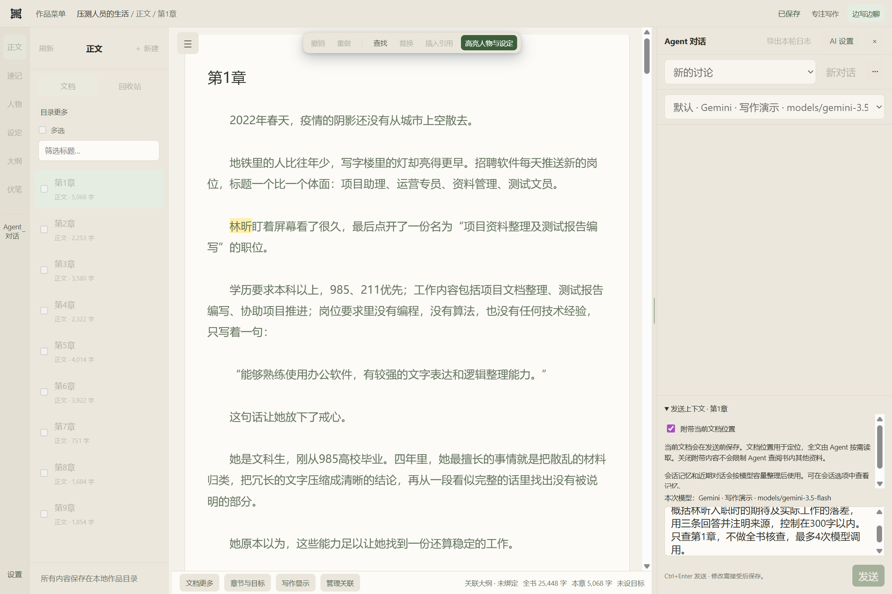

图：运行时可观察阶段、耗时、读取和提案数量，展开「本轮运行明细」了解过程。

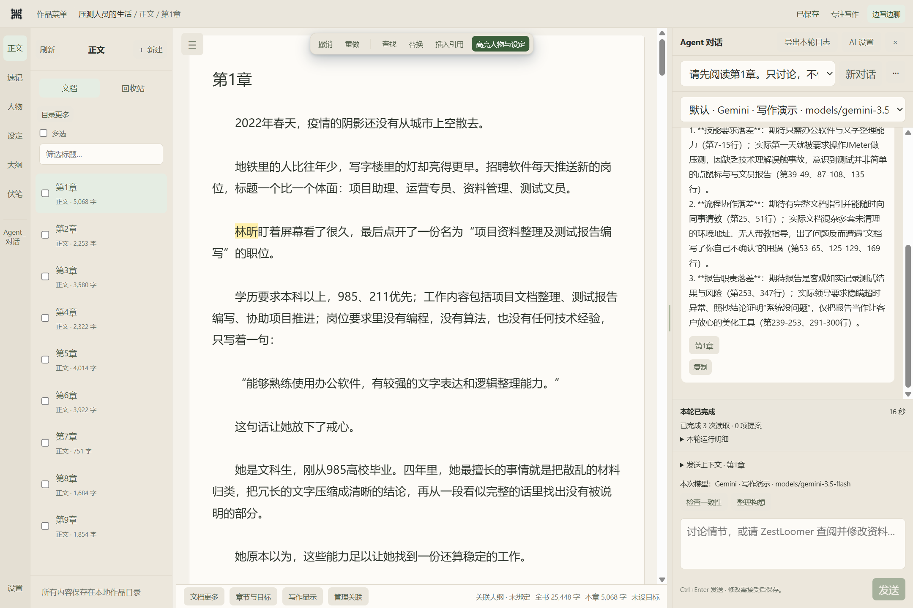

图：本次真实回复列出了3条入职期待与实际落差，并给出来源。请求约16秒完成，记录了3次读取、0份修改提案。

点击回答中的来源入口，回到对应文档核对原文。这里展示的是本次 Gemini 的实际回答；换一条要求或换一个模型，不应期待逐字相同的结果。

读取次数多，不等于已经完整评估每篇资料。目录和搜索摘要只是定位线索；检查全书时，特别留意回复列出的覆盖范围、遗漏和不确定项。

不满意时，可以继续补充限制，例如“只讨论第1章”“保留人物动机”“这只是备选构想，不要当成已发生的剧情”。需要中止时，使用运行中的取消入口。失败后可编辑原要求再重试，先解决连接或容量问题，避免反复发送整本书。

### 从讨论进入修改提案

以润色选区为例：

1. 在正文中选中需要润色的一段。
2. 检查发送上下文确实包含完整选区。
3. 说明修改目的和必须保留的内容，例如：

   > 只润色选区，增加约40–70字的办公室灯光与声音描写。保留人物态度、事件顺序和事实，不扩写其他情节。请生成修改提案，等我审阅。

4. 等待提案卡片，核对目标文档与修改范围。

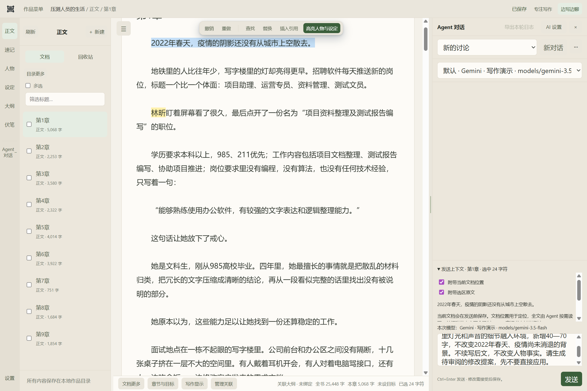

图：本次选择第1章开头的24个字符，展开上下文后核对选区完整，再发送润色要求。

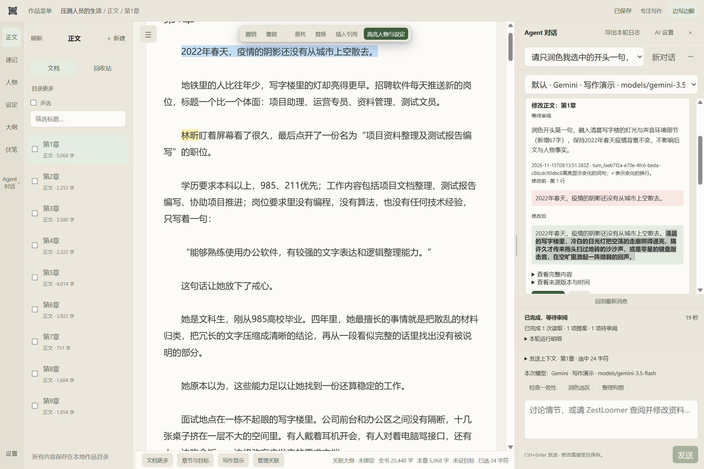

图：本次真实提案新增67个字符。先看差异和完整候选内容，再决定是否接受，不能只按新增字数判断是否合适。

审阅时逐项检查：

| 检查项 | 重点看什么 |
| --- | --- |
| 目标 | 是修改现有文档，还是新建文档？标题与类型是否正确？ |
| 范围 | 只想改一段时，是否碰到了其他内容？ |
| 事实 | 人物关系、时间、数字和关键设定有没有变化？ |
| 表达 | 新增内容是否符合人物口吻，与前后段落是否衔接？ |
| 来源 | 提案依据的原文版本是否仍适用？ |

选择「查看完整内容」可检查上下文。满意时点击接受；不满意时拒绝，或回到对话说明具体问题。

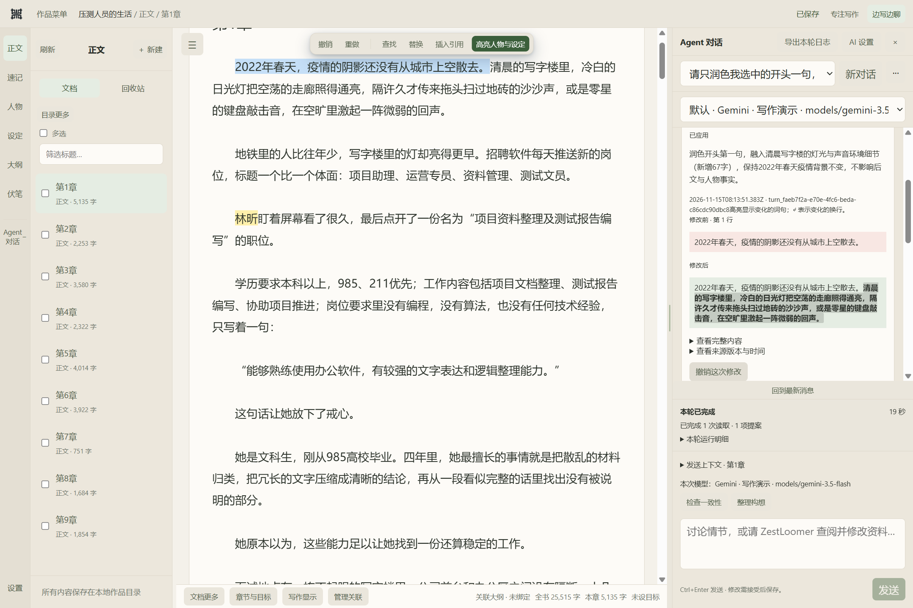

图：本次接受提案后，正文出现了对应变化。核对后又执行了撤销，确认全文恢复到接受前的内容。

自己操作时，也应先确认实际正文和保存状态，再决定是否继续沿用修改。不要把本例成功撤销理解为以后所有旧提案都能随时撤销。

**AI 说“已写好”，不等于内容已经写进作品。**以提案状态、实际文档和保存状态为准。

有选区时，文字替换按完整选区定位；没有选区时，可以明确要求按段落修改、在某段前后插入或在章末续写。当前开发版的正文提案可能同时统一完整候选的段落空行，选区外排版也可能变化，因此仍需检查完整差异。

提案基于生成时的目标版本。如果之后又编辑了目标，旧提案会被版本检查阻止；先保留需要的新稿，再让助手根据最新内容重新提案。来源资料改变时则会提示复核，不会仅因来源变化直接禁止采纳；仍应检查候选是否符合最新资料。已经接受后若又发生新修改，「撤销这次修改」也可能失效，此时通过历史版本比较处理。

来源变化、多份提案与运行日志

同轮多份提案可以分别接受，不必全部采纳。来源已变化时，核对“查看来源版本与时间”及提醒；来源提醒不代表候选已经与最新设定一致。目标文档自身仍会进行版本、草稿和回收状态检查。

任务结束或取消后，「导出本轮日志」可导出当前对话最近一轮的请求、回复和工具结果。每个对话只保留最近一轮完整日志；日志可能包含书稿、对话和本机路径，分享前先检查。

### 跨章检查：使用任务卡

对多章或多份资料的核查，可以在消息中直接说明范围、截止章节、输出形式和限制，例如：

> 请核查本作品前两章的人物动机与事件顺序，列出需要澄清的问题，并给出对应原文依据。只讨论，不生成修改提案。最多使用10次模型调用。

助手会按任务需要读取资料和安排检查。较短的问题可能直接回答；助手建立持续任务后，才会显示任务卡。

这里的任务由应用内助手处理，不需要启动外部程序；旧的外部 MCP 接入已移除。任务卡不是单独启动外部 subagent 的入口。

本例原稿共有9章，副本中的第10章是本指南新建的练习章。第一次核查先限定原稿前两章，便于检查引用和结果。需要检查整部原稿时，明确写“原稿第1至9章，不含指南练习章”，并核对最终报告是否确实覆盖了每一章。

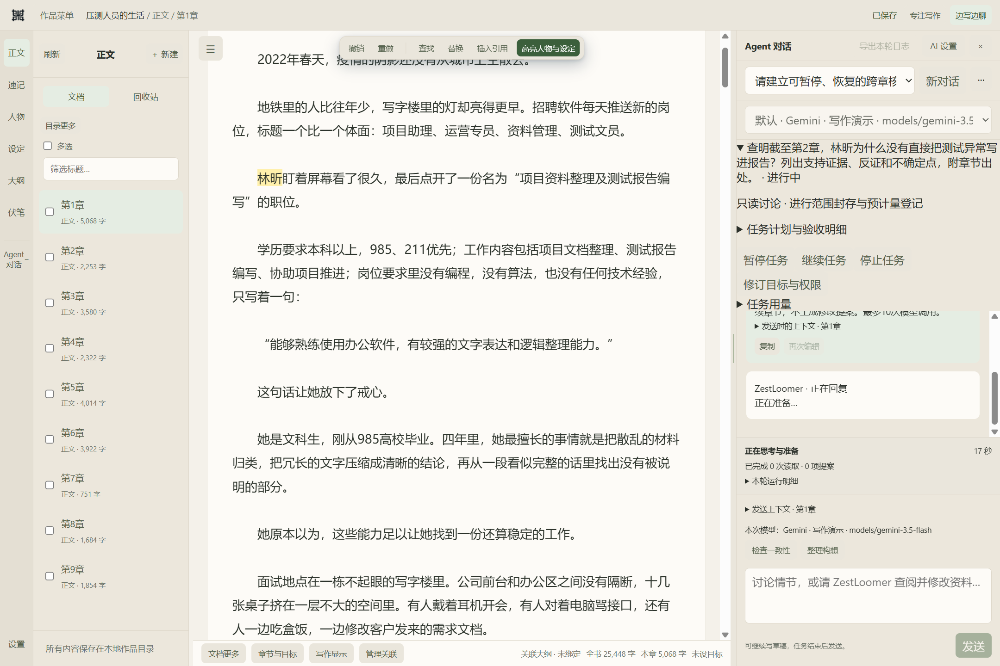

图：本次真实 Gemini 请求建立了任务卡。任务卡出现说明任务已建立，并不代表跨章检查已经完成。

需要暂时离开时，点击「暂停任务」；回来后点击「继续任务」。点击「停止任务」会结束该任务。正常关窗会保留可恢复进度；若出现保存失败提示，请先处理后再关闭。主动暂停的任务不会因为重新打开作品就自动恢复。

需要改变范围或允许提出修改时，使用「修订目标与权限」，核对任务目标、资料范围和操作权限，再保存。

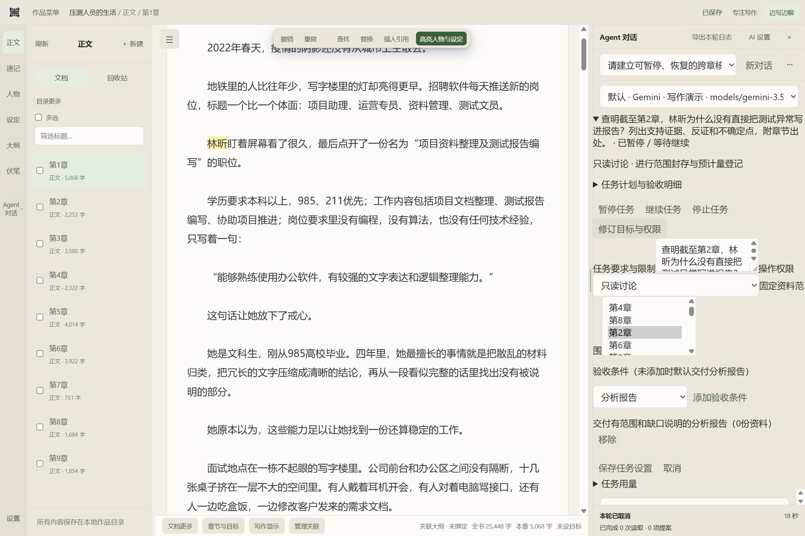

图：本次暂停任务后，将资料范围固定为第1章和第2章，保持「只读讨论」，保存设置并继续执行。允许生成提案是另一种权限，生成后仍需作者审阅。

### 达到调用上限后，怎样判断未完成状态

本次跨章演示已完成手动暂停、修订范围和继续操作；继续后达到了作者设定的10次模型调用上限。此时任务卡标题显示「执行失败」，运行区域显示「本轮未完成」，对话提示「已达到作者明确设置的任务预算上限，进度已保存」。**这一轮没有得到完成核查的交付。**

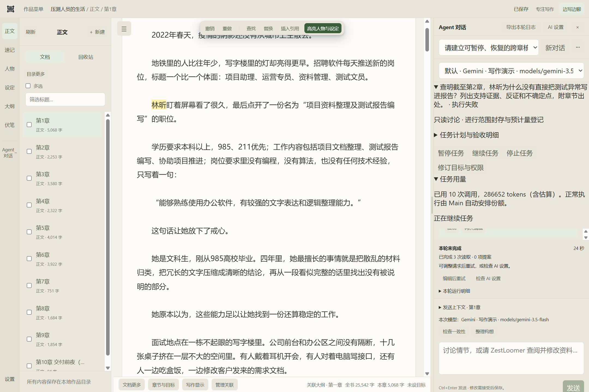

图：画面中可见「执行失败」、10 次调用与「本轮未完成」；具体原因还应回到对话查看预算上限说明。

本次画面中，卡片底部仍写着「正在继续任务」，与上方失败和未完成提示不一致。这是当前开发版需要注意的状态显示问题，不能只凭这一行判断任务仍在执行或已经完成。

遇到类似状态时：

1. 先看未完成原因、已用调用数和上限，区分达到上限、执行失败、等待作者答复和主动暂停。
2. 查看已经覆盖的资料和仍待处理的问题，不把“读取过”当成“评估完成”。
3. 若决定继续投入，先重新明确允许的范围与调用限制；也可以停止这轮，再针对尚未解决的小范围发起新要求。
4. 在没有调整限制前，不要反复点击「继续任务」，期待它自动越过作者设定的上限。

预算限制帮助控制投入，但不保证任务一定能在指定次数内完成。对初次使用，先从一章、一个问题开始，更容易判断模型有没有读对和答清楚。

本地开发版的长会话、全书检查与任务状态仍可能出现覆盖遗漏或不同步。不要只凭一份已输出的报告判断任务完成；同时核对任务卡、引用和实际检查范围。遇到上下文不足时，缩小范围或新建对话分段处理。

## 5. 整理人物、设定、大纲与伏笔

### 人物与设定：把可复用的资料写清楚

进入「人物」或「设定」，点击「＋ 新建」，填写名称，再选择「基础模板」或「空白」。

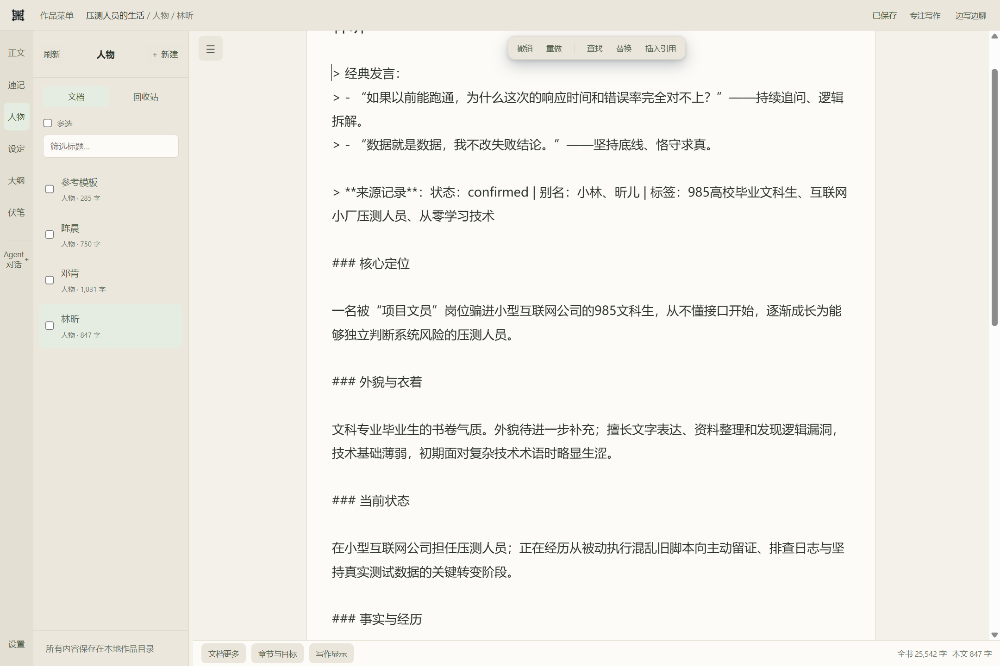

图：人物资料是可持续更新的文档，正文已发生的事实与未确定构想应分开记录。

人物模板提供核心定位、外貌与衣着、当前状态、事实与经历、经典发言。设定模板提供定义、规则与边界、具体内容与记录。可以补充自己的小节，不必为了填满模板而编造内容。

“经典发言”适合记录台词、语气和表达习惯，帮助助手参考人物口吻；不代表相同台词已经在正文中说过。需要记录别名时，可以单独写一行 `别名：林姐`，不要把别名和代表台词混为一谈。

正文工具栏的「高亮人物与设定」用淡色标出名称线索。没有高亮时，先检查开关、资料是否保存，以及名称或别名是否一致。高亮不能自动判断所有代词和同名人物。

新建作品自动添加两份只读教学示例，说明填写方法；示例不属于本书事实。可以复制为普通资料后改写，原示例不能直接编辑或回收。已有作品不会自动补入这些示例。

### 大纲和速记：规划与构想分别放好

大纲可以分成“全书总纲”“第一阶段”“下一章计划”等多篇文档，按需要调整顺序。速记用于暂未选定的方向、疑点和临时想法，按最近修改排列。

确定要落实的构想，再整理进对应大纲、人物或设定。与助手讨论时，也可以要求它区分“正文已发生”“大纲计划”和“速记构想”，并列出来源。

### 关联正文与章节大纲

1. 打开目标正文章节或大纲。
2. 点击底栏「管理关联」。
3. 选择对应文档，或使用「自动匹配」后逐项核对。
4. 从关联入口打开目标，确认没有绑错章节。

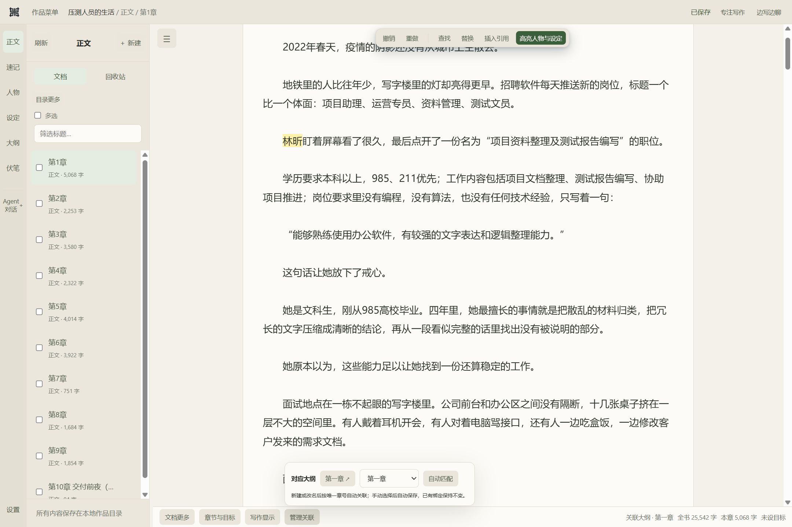

图：关联帮助在正文和计划之间跳转，不会自动同步两篇文档的内容。

自动匹配按可明确识别的章节编号查找；已有绑定会保留。回收或缺失的目标会显示标记，检查后再决定解除或重新绑定。

### 用伏笔表跟踪铺垫和回收

1. 选择左侧「伏笔」，点击「＋ 新增一行」。
2. 填写伏笔内容，选择开始章节和结束章节；暂不确定时可留为「未指定」。
3. 点击「保存此行」。需要放弃输入时，点击「取消修改」。
4. 使用章节旁的「↗」回到原文核对。

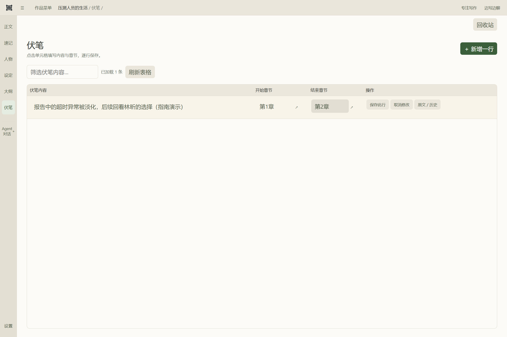

图：伏笔表按行保存，正文的自动保存不代替这里的「保存此行」。

表格可筛选、刷新和加载更多。离开前先保存或取消未完成的行编辑。「原文／历史」可查看底层记录；格式异常时可按提示打开原文修复，再返回表格。

## 6. 搜索、引用与返回原文

### 先选对搜索范围

| 想找什么 | 使用入口 |
| --- | --- |
| 当前分类里某个标题 | 列表上的「筛选标题…」 |
| 当前文档中的文字 | `Ctrl+F` 查找，`Ctrl+H` 替换 |
| 作品中的文档或一句原文 | `Ctrl+P`，选择按标题打开或「全书全文」 |

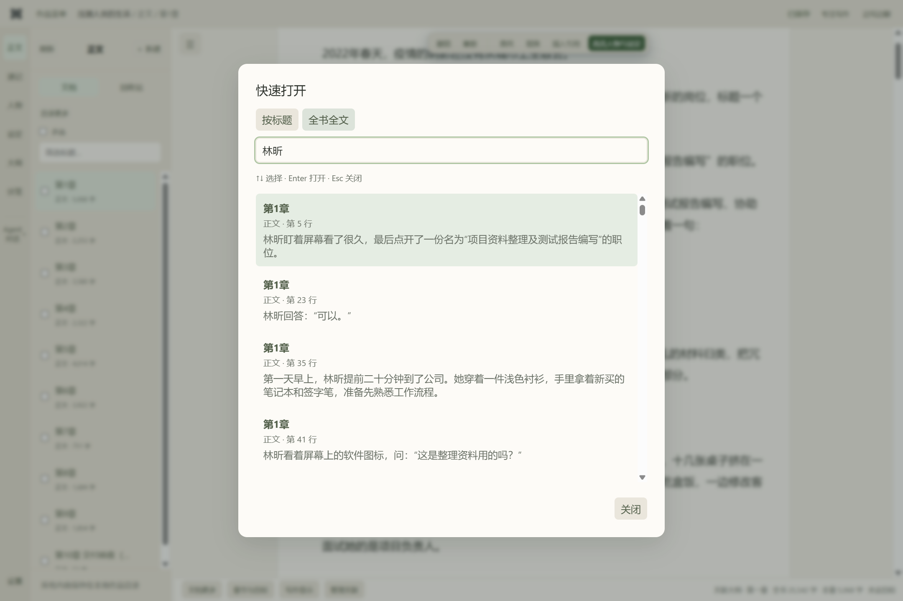

图：全文结果包含分类、标题、行号和片段；选择结果即可跳到相应文档。

快速搜索中可用上下方向键选择，按 Enter 打开，Esc 关闭。片段用于定位，判断情节和事实时继续阅读上下文。这里搜索的是当前作品，不是互联网。

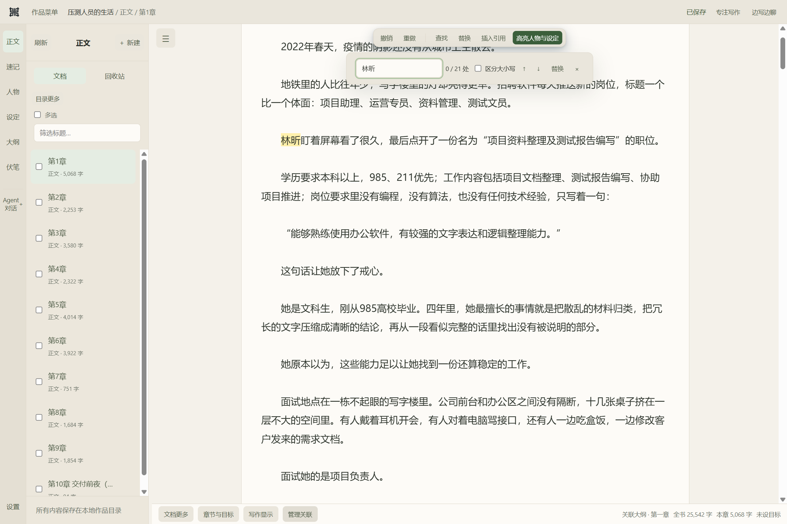

图：查找浮层不挤占正文；按 Enter 查下一处，Shift+Enter 查上一处，Esc 返回正文。

当前文档查找可切换大小写匹配，替换下一处或全部。执行全部替换前，先确认范围和匹配内容。只读文档可查找，不能替换。

### 插入引用并跳回资料

1. 把光标放到需要引用的位置。
2. 点击浮动编辑工具中的「插入引用」。
3. 按标题筛选并选择目标文档。
4. 在引用上 `Ctrl+点击` 打开目标；按 `Alt+←` 返回原位置。

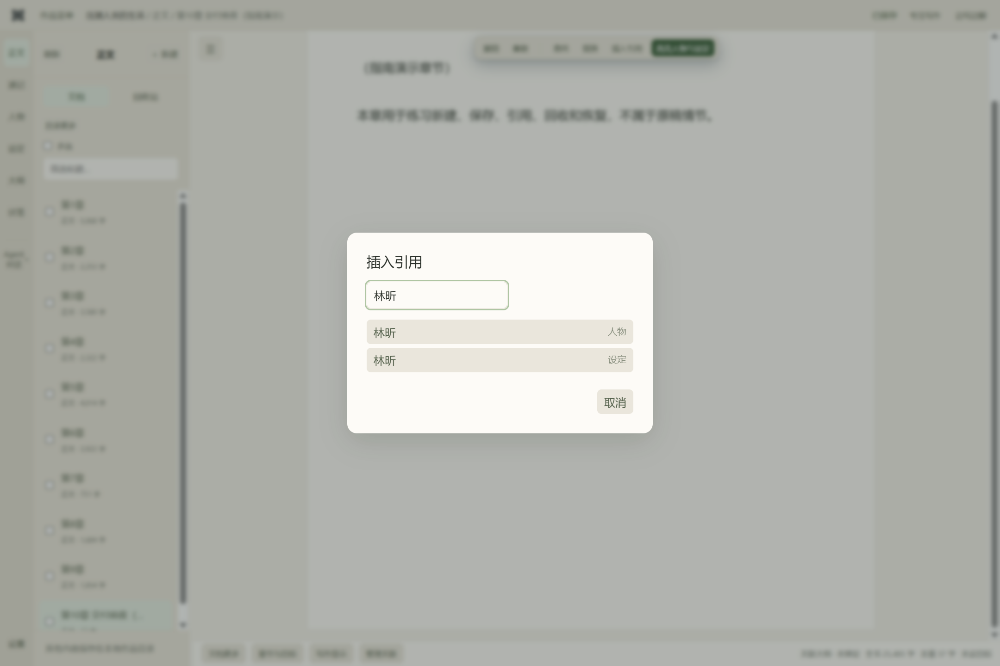

图：引用使用稳定的文档标识；更改文档标题后，不必手工重建所有引用。

被回收的文档仍可从引用打开，但处于只读状态。应用也会记住各文档的阅读位置和选区；内容缩短后，恢复位置会限制在现有文本范围内。

## 7. 历史、回收、导出与备份

### 比较并恢复历史

1. 打开目标文档，点击「文档更多 → 历史版本」。
2. 选择左侧的一条保存记录。
3. 比较历史内容与当前内容，核对标题和正文。
4. 确定需要恢复这一版后，点击「恢复所选版本」。

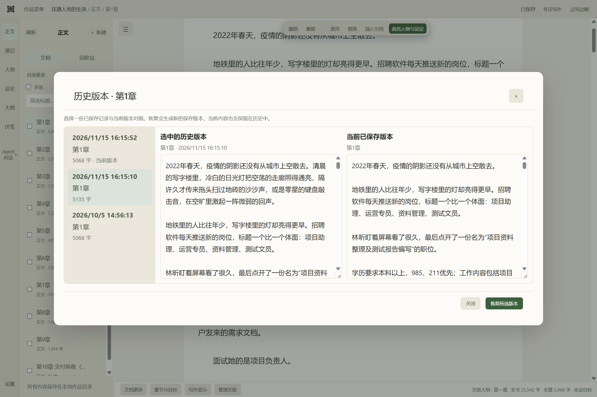

图：历史恢复可能同时涉及标题和正文，先完整比较，再恢复。

如果 AI 提案已接受后又继续编辑，不要强行套用旧撤销；历史对照更适合帮助找回特定内容。

### 回收与恢复文档

选择「文档更多 → 移入回收站」，确认后文档会从正常列表移出。进入原分类的「回收站」，选择文档，点击「恢复文档」。

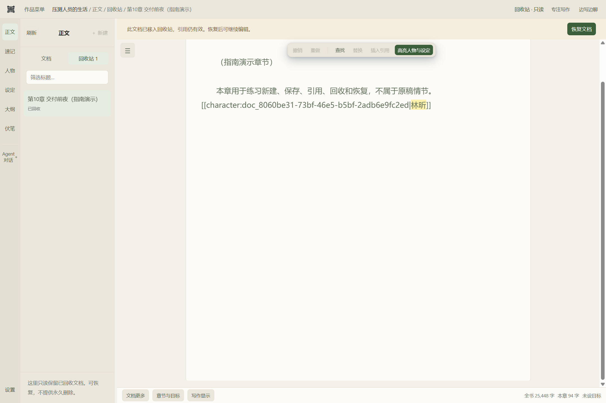

图：各分类分别管理回收站；找不到文档时，先检查它原先属于正文、人物还是其他分类。

当前没有永久删除和自动清理功能。被回收的资料不属于正常正文统计或正文导出范围。

### 分清导出和完整备份

| 目的 | 操作 | 包含什么 |
| --- | --- | --- |
| 交付当前一篇文档 | 「文档更多 → 导出」 | 当前文档内容 |
| 交付整本小说正文 | 「导出全部正文」 | 按章节顺序拼接标题与正文，不含回收站 |
| 保存可恢复的整部作品 | 「备份完整作品」 | 作品目录、各类资料及作品工作记录 |

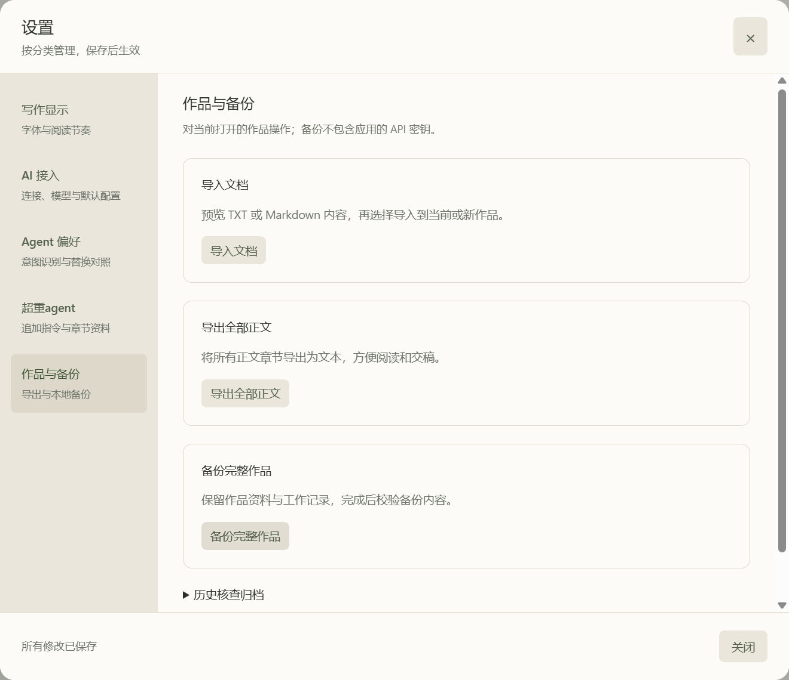

图：正文导出用于交稿；保留人物、大纲、历史和对话时，使用完整作品备份。

创建完整备份时：

1. 先处理未保存和冲突提示，并结束或暂停正在进行的操作。
2. 打开「设置 → 作品与备份 → 备份完整作品」。
3. 选择当前作品以外的保存位置。
4. 等待备份完成及内容校验提示，再检查生成的目录。

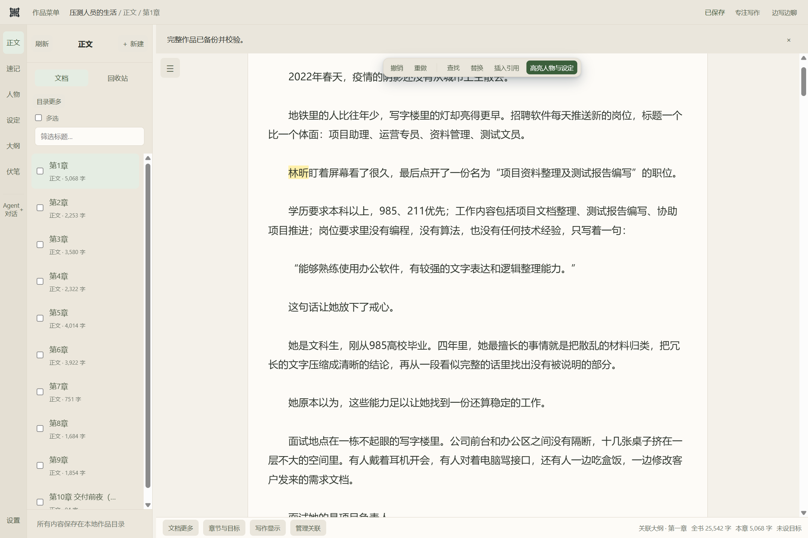

图：本次在演示副本中实际执行了正文导出和完整备份；以完成提示与生成的文件为准。

备份是目录副本，不是 ZIP。放在不同磁盘或其他可靠位置，才能应对原磁盘损坏。作品备份不含应用级 API 密钥；换电脑后，重新核对 AI 配置。

### 换电脑或从备份继续

关闭正在使用该作品的窗口，把完整副本复制到新位置，保留 `book.json`、各类文档目录和 `.workspace`。在 ZestLoomer 中选择「作品菜单 → 打开作品」，打开复制后的作品目录，核对章节、资料、历史和对话后继续。

目前没有单独的“从备份恢复”向导。只备份正文 TXT，无法恢复人物资料、对话、提案和历史。

外部编辑冲突与异常退出后的草稿

如果其他程序改过磁盘文件，而编辑器里保留了不同输入，应用会提供比较与选择：

- **稍后处理**：保留输入，暂不决定。
- **采用磁盘版本**：继续使用磁盘内容；选择前确认是否还需要留存当前输入。
- **保存当前输入**：明确把编辑器中的内容保存为新版本。

两份都需要时，先另存当前输入，再人工合并。不要反复点击保存跳过冲突。

异常退出后，重新打开作品时留意草稿恢复和保存提示，先核对恢复内容。自动保存、历史和独立备份各有用途，不能互相替代。

## 8. 调整显示与解决常见问题

### 让界面适合自己

打开「设置 → 写作显示」，调整浅色／深色／跟随系统、字体、字号和行高，检查预览后点击「保存显示设置」。字号范围为 12–32，行高为 1.2–3；字体还取决于电脑上是否安装。

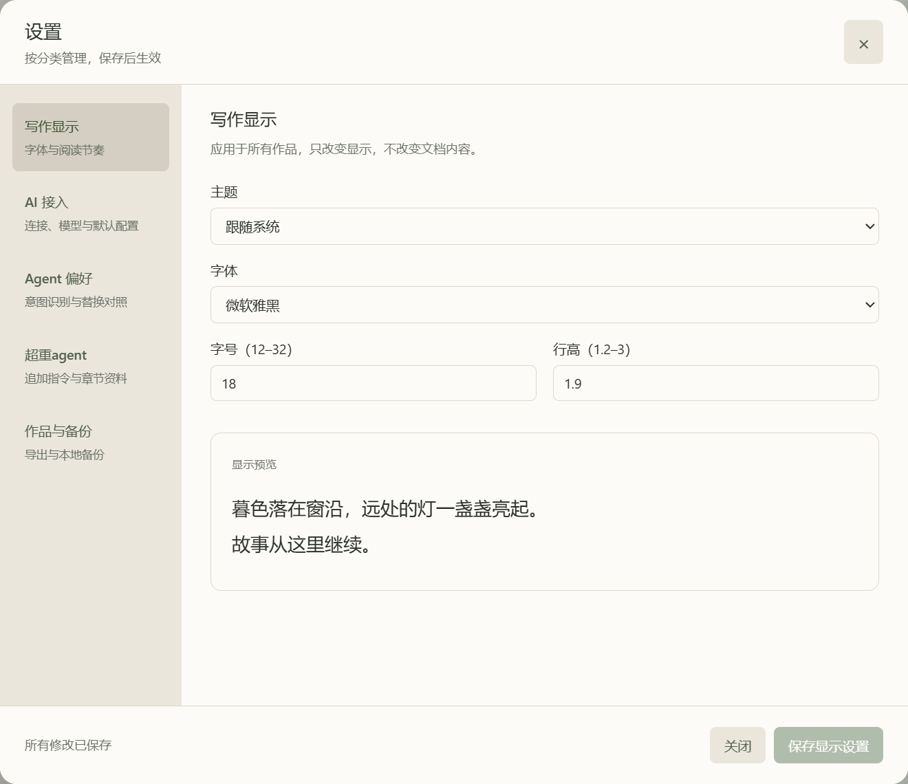

图：显示设置改变阅读和输入体验，不会改写文档正文。

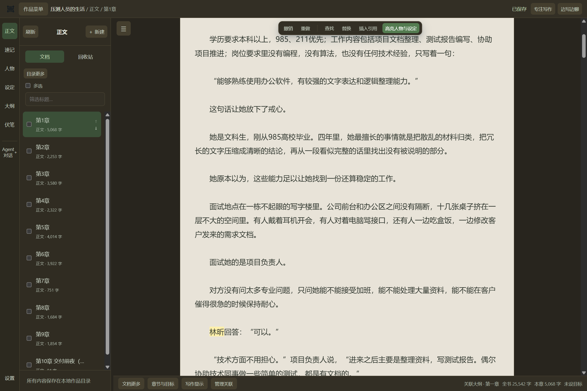

图：同一作品切换深色主题后的界面，正文内容保持不变。

「底栏 → 写作显示」还可设置版心宽度、工具是否常驻、打字机模式和中文选区配对。打字机与中文配对默认关闭。中文配对在正文选中非空文字后输入成对标点时生效，可一次撤销。

「专注写作」收起部分面板；`F11` 进入或退出全屏禅意。使用经典布局时，入口位置会与本指南不同，可从作品菜单切换布局。

### 常用快捷键

| 快捷键 | 操作 |
| --- | --- |
| `Ctrl+S` | 主动保存；设置窗口中保存当前修改 |
| `Ctrl+F` / `Ctrl+H` | 当前文档查找／替换 |
| `Ctrl+P` | 快速打开文档或搜索全文 |
| `Ctrl+Enter` | 发送当前 AI 消息；输入法组字时不会发送 |
| `Ctrl+Alt+↑` / `Ctrl+Alt+↓` | 上一章／下一章 |
| `Ctrl+点击` / `Alt+←` | 打开引用／返回原位置 |
| `F11` | 进入／退出全屏禅意 |
| 查找中 `Enter` / `Shift+Enter` | 下一处／上一处匹配 |
| 搜索或查找中 `Esc` | 关闭浮层，返回正文 |

### 遇到问题时先检查这些

| 现象 | 先做什么 |
| --- | --- |
| 打开作品提示格式不对 | 选择直接包含 `book.json` 的作品目录，不要手工创建空的 `book.json`。 |
| 测试连接成功，对话却不能完成任务 | 再测试工具调用，确认保存了配置，并检查当前对话的模型选择。 |
| 网络错误或 `fetch failed` | 检查地址、版本路径、模型、密钥和网络，先做两项配置测试。 |
| 报告没检查完，或提示上下文不足 | 核对覆盖范围与任务状态，明确章节范围，必要时新建对话分段检查。 |
| 不能接受或撤销提案 | 检查目标是否又修改、是否有未保存内容或冲突；基于最新稿重新提案，或比较历史。 |
| 找不到刚回收的文档 | 进入原分类，再打开它的回收站。 |
| 导出的 TXT 没有人物和聊天 | 正文导出的范围如此；搬迁作品应使用完整备份。 |
| Markdown 没变成排版后的文章 | 当前采用源码编辑，不提供渲染预览。 |

需要反馈时，记录版本、Windows 版本、操作步骤、预期与实际结果。AI 问题再补充模型、接入方式和两项测试结果。分享截图或日志前，检查其中的密钥、个人书稿、对话和本机路径。

书库设置和旧数据存放在哪里

选择 BookList 后，AI 配置、工具 API、工作区偏好和超重agent 指令共用该书库的配置。新书库使用 `.zestloomer`，已有旧书库沿用 `.loom`，不必手工改名。

作品正文、资料和工作记录位于各自作品目录；对话、提案和运行日志位于其中的 `.workspace`。单作品备份不包含书库级配置。即使复制应用配置，系统加密的密钥也不保证能在另一台电脑上直接使用。

当前开发版已移除旧外部核查接入。以前保留的结果和证据，可在「设置 → 作品与备份 → 历史核查归档」只读查看；不会恢复旧外部任务。详见 [历史核查归档与升级说明](audit-mcp.md)。

